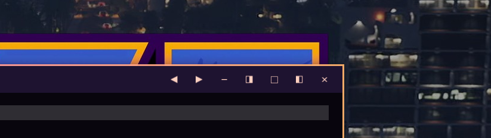

# Omarchy Floating Controls

Mouse-friendly window controls for Omarchy’s **floating workspace mode**.
Adds previous/next workspace and left/right half-screen buttons to Omarchy’s
native titlebars. Existing minimize, maximize and close controls remain.
No keyboard shortcuts are installed or changed.



- Filled ◀ / ▶ symbols, with colors inherited from the current theme.
- Move the clicked window without following it, including to empty workspaces.
- Some apps retain a minimum width in floating mode and may occupy more than
  half the screen, even if they can be narrower in tiling mode (see below).
- Half-screen placement respects the top bar, titlebar, borders, rotation and scaling.
- Actions are restricted to windows tagged by Omarchy’s floating workspace mode.

## Requirements and limits

This release targets Omarchy’s Lua configuration and native
`omarchy-hyprland-titlebars` package. Python 3 and `hyprctl` are required.
Workspace navigation currently supports Omarchy’s standard ten-slot monitor banks;
it reads the current monitor mapping, including `XDG_STATE_HOME`. Custom workspace
numbering is not yet supported. At the first/last slot the arrow does nothing.
Only four visible workspace slots in a bar does not limit navigation to four.
Compact-workspaces may renumber a workspace after a move; this extension does not
change that plugin’s settings. Special workspaces and guest workspaces outside the
monitor’s bank are excluded. Other titlebar extensions may conflict.

The shell plugin provides a setup panel; the titlebar controls themselves are
a Hyprland Lua integration. The integration wraps native button registration and therefore depends on
Omarchy’s titlebar API and loading order. Updates require compatibility checks.

On monitors with different scale factors, the native titlebar plugin can change
button glyph sizes when another floating window is created or resized. This was
reproduced with scales 1.0 and 1.5 and is tracked in
[omarchy-hyprland-titlebars #18](https://github.com/omacom/omarchy-hyprland-titlebars/issues/18).

### Minimum width in floating mode

Some windows cannot be resized to exactly half the screen in floating mode,
even though the same app can be narrower in tiling mode. Size constraints may
be handled differently between the two modes; a width observed in floating mode
should not be treated as an absolute limit of the app’s interface.

For example, in our desktop test Meeting Recorder stayed at 820 logical pixels
wide when the half-screen button requested a 596-pixel client area on a portrait
monitor. The user reported that the same app becomes narrower in tiling mode.
We have not yet verified whether overriding its floating-mode size constraint
preserves the full interface correctly.

Floating Controls currently does not override these constraints. After resizing,
it uses the accepted window width to anchor the window to the requested outer
screen edge. A window wider than half the screen therefore extends into the
other half rather than past the screen edge. A window wider than the entire
usable screen still cannot fit. This edge-placement behavior is included in
version 1.0.

## Install from Omarchy

```sh
omarchy plugin add https://github.com/Rockl0bster/omarchy-floating-controls.git --enable
```

Open **Floating Controls** in the bar or tray, read the explanation, and choose
**Install titlebar controls**. Choose both button sets, workspace arrows only,
left/right half-screen buttons only, or no customization (the original buttons).
No customization keeps the integration installed so it can be enabled again;
uninstall removes the Hyprland integration. To change an installed setup, select
another option and choose **Apply selection**. Installing the shell plugin alone does not modify
Hyprland configuration. The button copies the runtime files to
`~/.local/share/omarchy-floating-controls`, adds a Lua module link and one
`require` in `~/.config/hypr/hyprland.lua`, creates a backup of that file,
reloads Hyprland and checks for configuration errors. A conflicting personal
titlebar customization is not replaced automatically.

To remove the integration, open the panel and choose **Uninstall integration**
first, then run `omarchy plugin remove io.github.rockl0bster.floating-controls`.
Removing only the shell plugin leaves the separately installed titlebar
integration in place; re-add the plugin and use its remove button, or use the
manual uninstall command below. The runtime copy and backups are retained.

## Manual install

```sh
git clone https://github.com/Rockl0bster/omarchy-floating-controls.git
cd omarchy-floating-controls
python3 manage.py install
```

No sudo. Both installation methods copy runtime files to `~/.local/share/omarchy-floating-controls`,
links a Lua module under `~/.config/hypr`, backs up `hyprland.lua`, and inserts one
require before the Omarchy toggles import. Installation can be repeated.
The author's previous personal setup can be migrated with `--migrate-personal`;
its original files remain available but its require is removed to avoid duplicate buttons.

Manual selection: `python3 manage.py install --mode both`, `--mode workspace`,
`--mode halves`, or `--mode none`. An update without `--mode` preserves the saved selection.

### Ask a coding agent

You can also ask your coding agent to create a similar setup for you.
For example, copy this prompt:

```text
In Omarchy's floating workspace mode, add titlebar buttons that move the clicked
window to the previous or next workspace without following it, plus buttons that
place the window on the left or right half of the screen. Keep the existing
minimize, maximize, and close buttons, and do not change keyboard shortcuts.
Respect monitor scaling, screen edges, and the bar. Check my existing setup,
back up any configuration you change, and verify Hyprland after applying it.
Do not overwrite conflicting personal customizations.
```

Use this prompt at your own risk.
Creating a similar setup with a coding agent will likely use more tokens than
installing this repository and may therefore cost more.

## Manual update / remove

```sh
git pull --ff-only
python3 manage.py install
# Remove integration and restore native controls:
python3 manage.py uninstall
```

Removal preserves runtime files and backups for recovery, removes only our import
and symlink, and does not reactivate the old personal customization.

## Development

```sh
python3 -m unittest discover -s tests -v
```

Testing on multiple physical screens, theme changes and real pointer interactions
is part of the release checklist. Mock tests do not replace this visual validation.

MIT license. Uses Omarchy’s installed titlebar plugin; does not bundle its native code.
